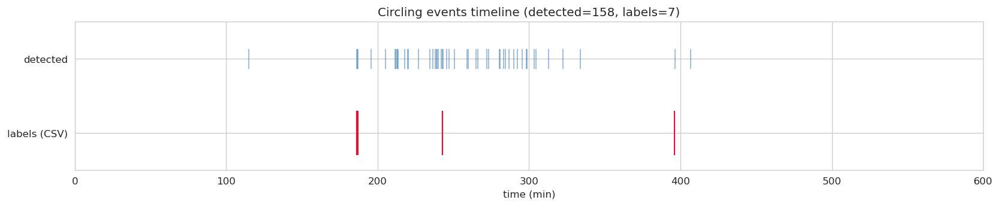
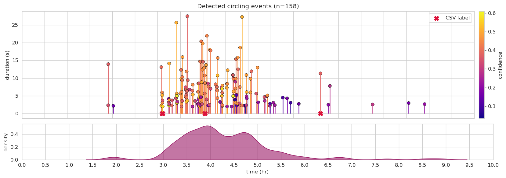
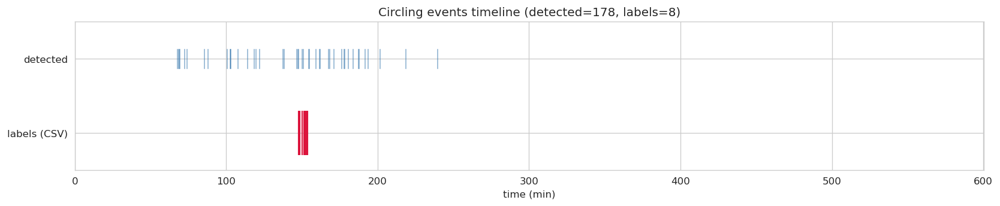
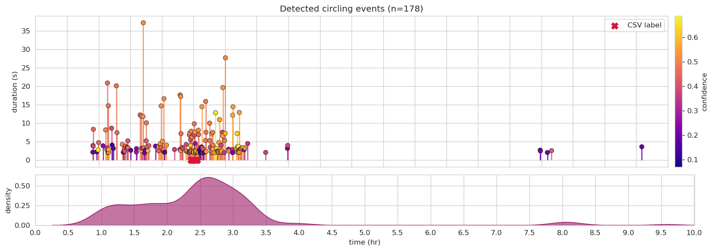
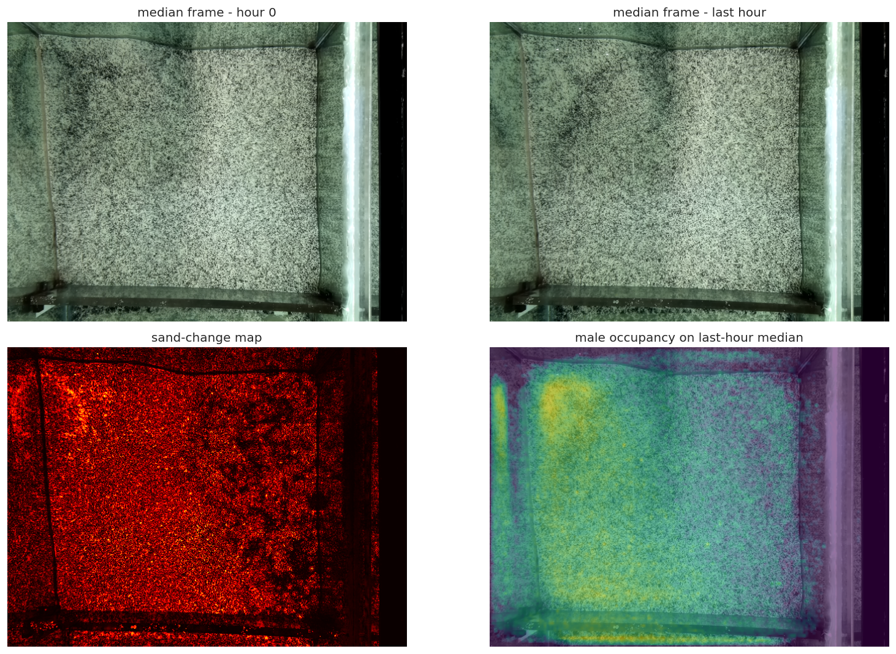

# Ground-Truth Annotations

Human-verified labels for **circling** courtship events in overhead Lake
Malawi cichlid tank videos. Each event span is annotated with its temporal
boundaries, rotation direction (CW / CCW), number of completed turns,
location within the tank, and free-text notes. These labels serve as the
ground truth for every downstream detector / evaluator in this repo
(see for example `models/optical-flow/`).

## Folder layout

```
ground_truth_annotations/
├── data/                       # source videos (not committed; add locally)
│   ├── 0002_vid.mp4
│   ├── 0007_vid_day05.mp4
│   ├── 0007_vid_day06.mp4
│   ├── 0013_vid.mp4
│   ├── 0018_vid.mp4
│   ├── 0028_vid.mp4
│   ├── 0031_vid.mp4
│   └── 0037_vid.mp4
└── finalized_annotations/      # one CSV per video (human-verified)
    ├── circling_annotations_vid0002.csv
    ├── circling_annotations_vid0007-day5.csv
    ├── ...
    └── ground-truth-annotation-working-sheet.xlsx   (master sheet)
```

Mp4 files are excluded from version control (`.gitignore`); place them
into `data/` locally before running any downstream code.

`hard_negatives/hard_negatives_annotated.csv` carries the video ID, event ID
and inclusive frame bounds from the `Hard negatives` sheet of the reviewer
workbook. XGBoost uses these intervals as background examples. Any frames that
also appear in finalized positive annotations keep their positive label.

## Annotation CSV schema

Columns in each `circling_annotations_vid<id>[-day<N>].csv`:

| column | meaning |
|---|---|
| `VideoID` | short alias for the source video (one per annotation row) |
| `EventID` | unique identifier `vid<N>-v<id>[_d<day>]_evt_<NNNN>` |
| `StartTime`, `EndTime` | HH:MM:SS boundaries of the event in source-video time |
| `Start Frame`, `End Frame` | corresponding frame indices (source fps) |
| `Primary label/behavior` | always `Circling` in this file |
| `Rotation direction` | `CW` or `CCW` as seen in the overhead view |
| `No. of turns/circles` | integer or `.5` half-turn increments |
| `Event Location` | region of the tank (e.g., `Bower`, `Center`) |
| `Secondary label/behavior` | optional (e.g., chasing before/after the event) |
| `Annotator comments/notes` | free text from the first annotator |
| `Reviewer comments/notes` | free text from the second reviewer |

Frame rate for the current set is **30 fps**.

## Annotation protocol

Every video goes through two stages: an optional automatic candidate
generation, followed by two independent human passes. Together this
produces a **doubly-labelled dataset of 80 h** (8 videos × 10 h each).

### Stage 1 (optional): automatic candidate generation

A heuristic detector (see [Auto-annotation rule](#auto-annotation-rule)
below) proposes candidate circling spans from pose / track data. This
stage is **optional but highly useful**:

- It lets annotators focus on specific regions of the video instead of
  watching 10 h end-to-end, materially speeding up the labelling pass.
- Humans occasionally miss short / subtle circling bouts; the detector
  does not, so the two together achieve better recall than either alone.

### Stage 2: human review (two passes)

#### Pass 1 -- first human annotator (the actual labelling)

The first annotator carefully observes the video (optionally seeded with
the stage-1 candidates) and produces one labelled row per circling event:
`EventID`, `StartTime` / `EndTime` and the corresponding frame indices,
`Rotation direction`, `No. of turns/circles`, and `Event Location`.
Ambiguous cases, interruptions, and any notes about the bout go into
`Annotator comments/notes`.

#### Pass 2 -- second human reviewer

The second reviewer independently checks the three output fields that
matter most for downstream use:

1. event span (`StartTime` / `EndTime` and the corresponding frame
   indices),
2. `Rotation direction`,
3. `No. of turns/circles`.

If anything looks potentially mis-labelled, the reviewer records the
concern in `Reviewer comments/notes`. Agreement between the two passes
is the source of the "doubly-labelled" quality of this dataset.

The criteria used by both passes to decide *what counts as a circling
event* are documented in the next section.

## Manual annotation criteria

### What counts as a circling event

1. **Pair composition.** A single male–female pair, both visually
   distinct (relying on the fact that there is only one male in the
   tank).
2. **Proximity.** The two fish are **less than 1-1.5 body lengths**
   apart (eyeballed).
3. **Smooth curved motion.** The movement of the *leading* fish (usually
   the male in MC species) traces a **circular path** — rectangular,
   zig-zag, or stop-start trajectories (rhombus / parallelogram patterns)
   do not qualify. The two fish do not have to be in a perfect curved
   anti-parallel position throughout the span, but the leader's path
   must be circular.
4. **At least one full turn** (≥ 360° rotation) completed by the
   leading fish. *(Strict criterion.)*
5. **Direction change ⇒ new event.** If the pair switches rotation
   direction within what might otherwise be one event, the current event
   ends and a new one starts.
6. **Minimum duration.** The bout must last **≥ 3 s**.
7. **Merge adjacent bouts** if they are separated by **< 2-3 s** AND
   (a) the rotation direction is the same, AND (b) neither fish leaves
   the local region between the two bouts. Otherwise they stay as
   separate events.

### Entry and exit-point definitions

Precise boundaries are essential for consistency across annotators.

- **Entry point** — the timestamp / frame at which **at least one of the
  fish starts the circular motion** while the pair is close to each
  other and in anti-parallel orientation.
- **Exit point** — the timestamp / frame at which **either fish breaks
  away** from the circular motion (or from anti-parallel orientation)
  and does **not** resume circling within the next 2-3 s.

### Counting turns

- Each full 360° sweep by the **leading fish** counts as one turn.
- A **partial turn** is recorded as a half-integer (e.g., `1.5`, `2.5`).
- Whether a final partial turn counts depends on where the exit point
  lands relative to the entry point:
  - Entry and exit are close together with the same tail-to-head
    direction ⇒ the last turn is **complete**.
  - The fish initiated a new turn but broke away midway ⇒ the last
    turn is **partial**.

## Auto-annotation rule

The heuristic detector that generates candidate events for the first
human pass. Operates on `df_pairs` (one row per `FrameNum` + ordered
pair of `TrackUID`s). All six conditions must hold for a row to be
flagged as a candidate circling frame:

1. `pair_sex == "FM"` — one male and one female in the pair.
2. `centroid_distance_bl < 1.5` — centroid distance normalised by the
   pair's mean body length stays within 1.5 body lengths.
3. `cos(rel_heading_rad) < -0.2` — fish headings within ~78° of
   perfectly anti-parallel.
4. `sign(d_heading_1) == sign(d_heading_2) == sign(d_orbital)` — all
   three angular velocities co-rotate and are non-zero.
5. `abs(d_orbital_rad_s) >= 0.5` — orbital angular speed of at least
   0.5 rad / s, i.e. at least one revolution per ~12.5 s.
6. `qc_n_missing_kp_1 <= 2 AND qc_n_missing_kp_2 <= 2` — at most 2
   missing keypoints per fish.

Temporal post-processing after the per-frame flags:

- **Persistence**: a run of flagged frames must be at least 2.0 s long.
- **Dropout tolerance**: up to 1.0 s of `False` frames allowed inside
  a run.
- **Merge**: two adjacent runs separated by at most 2.0 s stitch into
  one event.

Thresholds live in `src/circling.py` as module-level constants and can
be overridden at the call site.

## Setup for the auto-annotation / EDA pipeline

```bash
cd ground_truth_annotations
conda env create -f environment.yaml
conda activate cichlid-vision
```

Then open `notebooks/Cichlid-analysis.ipynb` in Jupyter and run the
cells top to bottom. Place the required mp4 / parquet files into
`data/` before running (heavy files are excluded via `.gitignore`).

## Results (seed videos)

Detected events against CSV labels. Blue bars are detected events
(horizontal length = event duration); crimson ticks mark the midpoint
of each CSV-labelled circling span.

### vid_0028 (MC920)




### vid_0031 (F1_613)




## Downstream EDAs

### Pose-overlay clips

For every CSV-labelled circling event, `batch_render_circling_clips`
reads the matching source mp4 over `[StartFrame, StopFrame]` and writes
a pose-annotated clip to `data/circling-events/`: per-keypoint dots,
sex-colored skeleton, heading arrow, and Sex / TrackID label on each
frame. Used for visually auditing the CSV ground truth.

The folder is currently empty; generated mp4 files are large and are
excluded via `.gitignore`.

### Bower detection

Two independent locators combined:

1. **Sand-change map** — pixelwise median of frames sampled across
   hour 0 vs. the last hour; the absolute difference highlights where
   sand has been moved.
2. **Male-only occupancy heatmap** — 2-D histogram of male centroids.
   Males build and defend bowers, so density concentrates there.


